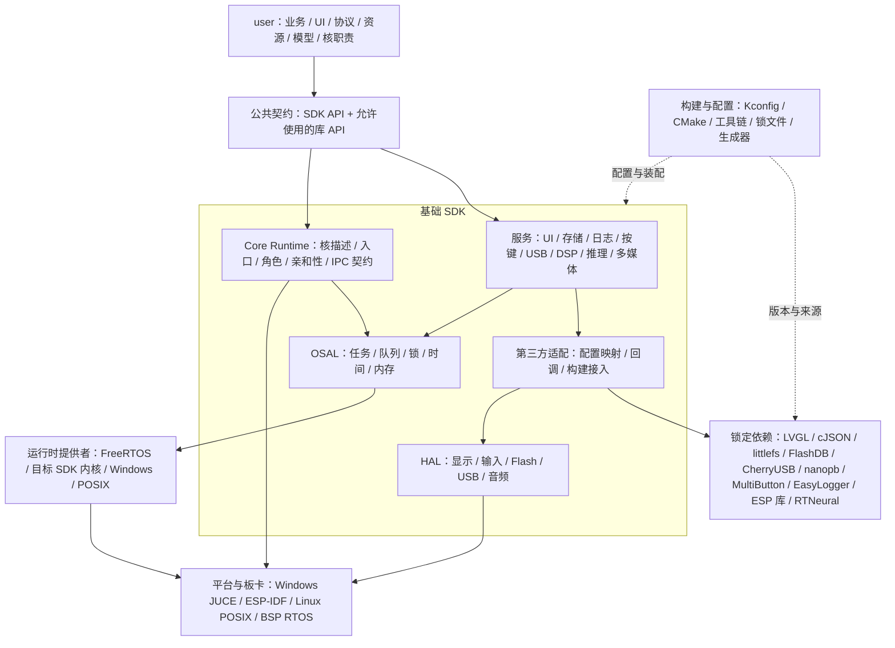
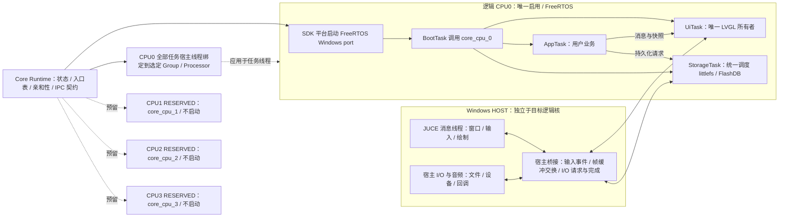

# JUCE / LVGL 可移植开发 SDK 架构草案

更新日期：2026-10-31（Asia/Shanghai）。

状态：架构设计基线。目录树包含后续规划；已实现与实测范围以 [implementation-status.md](implementation-status.md) 为准，不将预留后端视为已支持平台。

## 1. 目标与第一阶段边界

构建一个以 Windows / JUCE 为开发环境、可向嵌入式 SDK 集成的组件式 SDK。项目使用 VS Code、Git、CMake/Ninja、Kconfig 与统一构建入口。第三方依赖、配置、代码生成和平台适配由基础 SDK 管理。

| 项目 | 约定 |
| --- | --- |
| Git | 同一仓库保存 SDK 与产品分支；使用 worktree 分别开发 |
| SDK 基线 | `sdk/main`；已验证版本使用 `sdk/vX.Y.Z` 标签 |
| 产品区域 | `user/`，包含业务、界面、协议、模型、资源、逻辑核职责 |
| Windows 主配置 | 实际 FreeRTOS Windows port，CPU0 为唯一启用的目标逻辑核 |
| 多核预留 | 核描述、核入口、角色分配、宿主亲和性接口；CPU1 及以后默认 RESERVED |
| 第一阶段不启动的能力 | 辅助核线程、辅助核业务、FreeRTOS SMP、多内核 AMP、自动负载迁移 |
| 主核任务 | UI、应用、存储等任务均处于 CPU0 的同一 FreeRTOS 调度域 |
| JUCE 宿主 | 消息线程、窗口、输入、音频及桌面 I/O，独立于目标逻辑核编号 |
| 移植交付 | `user/` + SDK 公共接口契约 + 目标平台适配组件 + 兼容依赖配置 |

Windows 原生 OSAL 可作为独立的快速测试配置，但不替代本阶段要求的 CPU0 / FreeRTOS 主配置。

## 2. 软件依赖方向

1. `user/` 使用 SDK 公共接口，以及允许直接使用的 LVGL、cJSON、nanopb 等公共 API。
2. SDK 服务处理文件、KV、日志、按键、通信、DSP、推理和多媒体语义。
3. 第三方适配层处理编译选项、配置头、运行时配置结构、内存钩子和回调。
4. OSAL 处理任务、同步、时间和内存约定；HAL 处理显示、输入、块设备、USB、音频等设备约定。
5. 平台与板卡实现实际运行时、工具链、设备、分区和启动流程。

通用公共接口优先采用 C，使用不透明句柄。JUCE、RTNeural 等 C++ 实现留在 SDK 内部。第三方 API 的直接使用仍受 SDK 的版本、功能配置和线程归属约束。

软件分层图源：`diagrams/software-topology.mmd`。



## 3. 多核语义

### 3.1 三种编号分别管理

- **SDK 逻辑核 ID**：CPU0、CPU1 等，表示产品中的核职责槽位。
- **目标硬件核 ID / 调度域**：由板卡与目标 SDK 定义，可能包含不同架构、不同操作系统或不同内存域。
- **Windows 宿主处理器**：Processor Group + Logical Processor，由本机允许使用的处理器集合决定。

SDK CPU0 不直接等于 Windows 处理器 0。绑核是对 Windows 调度亲和性的约束，不是 CPU 指令、缓存、中断、内存一致性或芯片时序仿真。

预留四个逻辑槽位只是初始配置示例，不表示每款芯片都有四个同构可用核。异构 MCU/协处理器需要独立的架构、内存域和启动方式描述，不能直接当作同一 FreeRTOS 实例中的额外核。

### 3.2 第一阶段核表

| 逻辑槽位 | 状态 | 运行时 | 入口 | 第一阶段行为 |
| --- | --- | --- | --- | --- |
| CPU0 | ENABLED | FreeRTOS | `core_cpu_0()` | 初始化用户职责，启动 UI / App / Storage 服务 |
| CPU1 | RESERVED | 未分配 | `core_cpu_1()` | 保留接口，不创建宿主线程，不执行入口 |
| CPU2 | RESERVED | 未分配 | `core_cpu_2()` | 保留接口，不创建宿主线程，不执行入口 |
| CPU3 | RESERVED | 未分配 | `core_cpu_3()` | 保留接口，不创建宿主线程，不执行入口 |

### 3.3 入口契约

建议的 C 接口原型如下，仅为待实现设计：

```c
typedef struct sdk_core_context sdk_core_context_t;

void core_cpu_0(const sdk_core_context_t *ctx);
void core_cpu_1(const sdk_core_context_t *ctx);
void core_cpu_2(const sdk_core_context_t *ctx);
void core_cpu_3(const sdk_core_context_t *ctx);
```

`core_cpu_x()` 是这一组职责入口的统称。上下文提供逻辑核 ID、运行时类型、调度域及可用能力。

- 入口是运行时就绪后的职责初始化钩子，由 SDK 调用一次，允许返回；返回后的任务清理由 SDK 包装层处理。
- Windows 平台先由 SDK 启动内核，再通过 CPU0 的 BootTask 调用 `core_cpu_0()`。
- ESP-IDF 复用已启动的调度器，由 `app_main()` 桥接；用户入口不调用 `vTaskStartScheduler()`。
- 用户代码通过 OSAL 创建后续任务；FreeRTOS 内核启动不放在 `user/`。
- 各核入口不等同于硬件复位向量。辅助核启动、共享内存准备和中断路由属于 BSP。
- RESERVED 核默认完全不启动；后续启用前必须检查运行时和后端能力。
- 使用显式入口表注册及构建选择，避免依赖不统一的 weak 符号覆盖行为。

### 3.4 Windows 绑核

`platforms/windows/freertos/` 管理 Windows port 的线程创建适配点，`platforms/windows/core/` 管理宿主 CPU 枚举和亲和性。

- 枚举进程实际可使用的处理器，生成逻辑核到 Group / Processor 的映射。
- CPU0 的所有 FreeRTOS 任务宿主线程，包括内核创建的 Idle / Timer 任务线程，应用同一 CPU0 映射。仅给启动调度器的线程绑核是不够的。
- Tick / 模拟中断等辅助线程单独标明为运行时基础线程，并明确其亲和性策略。
- JUCE 消息线程、宿主 I/O、音频回调是 HOST 上下文，不计入目标 CPU0 职责。
- 亲和性设置必须检查返回值；严格模式下失败即启动失败。可选的未绑核测试模式必须明确记录。
- 宿主允许使用的处理器不足时拒绝启用额外的严格绑核槽位，或显式选择共享宿主处理器的测试模式。
- 主核编号、宿主处理器编号和实测线程亲和性应能在日志中区分。

### 3.5 SMP 与 AMP 的后续映射

| 后端 | 核职责如何实现 |
| --- | --- |
| Windows 第一阶段 | 单 FreeRTOS 调度域只服务逻辑 CPU0；其他入口保留 |
| ESP-IDF SMP | 核职责入口映射为绑核初始化任务，业务任务由 OSAL 指定目标核 |
| ESP-IDF 单核配置 | 用原生单核配置限制调度到 CPU0，其他职责保持未启用 |
| RK3506 Linux / POSIX | 在 Linux 用户态建立任务亲和性；内核启动与 CPU 管理由 Linux/BSP 拥有 |
| BSP 支持的 AMP | 由 BSP 启动独立固件/运行时，再调用对应职责入口 |

同一 SMP 内核中的任务亲和性与独立运行时的核启动是不同能力。不能为每个 SMP 核各启动一个调度器，也不能从 SDK 接管目标 SDK 已经拥有的核。

RK3506 有三颗 Cortex-A7，并包含不同架构的 M0。具体 Linux / RTOS 分工、可用核和启动方式需针对选定板卡与 BSP 确认，当前只预留适配结构。

### 3.6 IPC 预留

公共接口预留核状态、消息发送和通知能力。第一阶段仅固定消息契约，不承诺跨核传输已经实现。

- 同一调度域可由后端使用 RTOS 队列。
- 独立运行时/内存域使用邮箱、共享内存或其他 BSP 通道，处理缓存维护与内存屏障。
- 跨域消息使用明确长度、消息类型和可序列化数据，不传 JUCE、LVGL、任务或队列句柄。
- 不将同一内核的 FreeRTOS QueueHandle 作为通用 AMP 通信接口。
- 缓冲区必须规定所有权、生命周期及背压方式。

## 4. Windows 运行拓扑

图源：`diagrams/runtime-topology.mmd`。辅助核节点表示接口预留，不表示已经创建线程。



LVGL 对象只由 UiTask 使用。持久化服务串行拥有存储实例；共享 Flash 控制器和不同分区的访问由底层统一仲裁。JUCE 读取已发布的帧缓冲或快照，不直接并发访问正在修改的 LVGL 对象。帧交换需要明确的缓冲区发布、消费和复用协议。

FreeRTOS 任务不能随意直接执行可能阻塞宿主线程的 Windows/JUCE 调用。宿主桥接处理跨上下文请求，遵守选定 Windows port 的线程与模拟中断规则。

## 5. 计划目录

```text
C:\LeyueFiles\Project\LVGL_JUCE\
├─ CMakeLists.txt
├─ CMakePresets.json
├─ Kconfig
├─ README.md
├─ .gitignore
├─ .gitattributes
├─ .vscode/                         # 共享任务、调试、扩展建议
├─ sdk/
│  ├─ include/sdk/                  # 公共 C 接口
│  │  ├─ sdk.h
│  │  ├─ core.h                     # 核描述、状态、能力
│  │  ├─ os.h                       # OSAL
│  │  ├─ ipc.h
│  │  ├─ storage.h
│  │  ├─ log.h
│  │  ├─ dsp.h
│  │  └─ multimedia.h
│  ├─ runtime/
│  │  ├─ boot/                      # 初始化与退出顺序
│  │  ├─ core/                      # 核入口表、状态机、角色装配
│  │  └─ ipc/                       # 消息契约、传输后端装配
│  ├─ osal/
│  │  ├─ freertos/
│  │  ├─ win32/                     # 可选快速测试后端
│  │  ├─ posix/                     # 将来 Linux 接入
│  │  └─ baremetal/                 # 能力受限的轮询后端
│  ├─ hal/                          # 设备接口与公共数据类型
│  ├─ services/                     # UI、存储、日志、按键、协议、USB 等
│  ├─ adapters/                     # 每个第三方库的配置与运行时接入
│  ├─ config/                       # Kconfig、配置映射、模板
│  └─ porting/                      # 移植契约与兼容检查
├─ platforms/
│  ├─ windows/
│  │  ├─ host_juce/                 # 宿主程序与窗口
│  │  ├─ freertos/                  # Windows port、任务线程亲和性适配
│  │  ├─ core/                      # CPU 枚举、Group / Processor 映射
│  │  ├─ bridge/                    # 输入、帧、I/O 请求桥接
│  │  └─ devices/                   # 模拟 Flash、GPIO、音频等
│  ├─ esp_idf/                      # 复用原生内核与组件系统
│  ├─ linux_posix/                  # 预留 Linux 后端
│  └─ bsp_rtos/                     # 预留其他厂商 BSP 接入
├─ boards/
│  ├─ windows_sim/
│  │  ├─ board.cmake
│  │  ├─ defconfig
│  │  ├─ topology.yml               # 核槽位、运行时域、硬件能力
│  │  └─ partitions.yml
│  └─ <vendor>/<board>/             # 确认实际板卡后加入
├─ third_party/
│  ├─ manifest.yml                  # 原始仓库与来源
│  ├─ deps.lock.json                # 精确版本、提交、摘要、间接依赖
│  ├─ recipes/                      # 获取与构建规则
│  ├─ patches/                      # 必要且可追踪的修改
│  └─ notices/                      # 随选定依赖保留的声明
├─ cmake/
│  ├─ toolchains/
│  ├─ modules/
│  └─ bridges/                      # standalone、ESP-IDF、已有 SDK
├─ user/
│  ├─ CMakeLists.txt                # 只描述用户源码和应用目标
│  ├─ app.conf                      # 产品功能与资源需求
│  ├─ cores/
│  │  ├─ core_roles.c               # 产品职责表
│  │  ├─ core_cpu_0.c
│  │  ├─ core_cpu_1.c               # 预留
│  │  ├─ core_cpu_2.c               # 预留
│  │  └─ core_cpu_3.c               # 预留
│  ├─ app/
│  ├─ domain/
│  ├─ ui/
│  ├─ protocol/                     # .proto 与 .options
│  ├─ assets/
│  ├─ models/
│  └─ tests/
├─ examples/
├─ templates/user/                  # SDK 分支中的产品模板
├─ tools/
│  ├─ sdk.py                        # 计划的统一入口
│  ├─ deps/
│  ├─ config/
│  ├─ codegen/
│  └─ export/
├─ tests/
│  ├─ contracts/
│  └─ integration/
├─ docs/
│  ├─ architecture.md
│  └─ diagrams/
│     ├─ software-topology.mmd
│     └─ runtime-topology.mmd
├─ .local/                          # 本机 CPU 映射覆盖；Git 忽略
├─ .cache/                          # 已锁定的依赖源码；Git 忽略
└─ out/                             # 按产品、板卡、配置隔离；Git 忽略
```

SDK 分支保存示例和 `templates/user/`。具体产品分支创建自己的 `user/`；SDK 升级尽量不改产品文件。本机 Group / Processor 选择不写入可移植用户业务。

## 6. 第三方库接入策略

所有库在基础 SDK 中集中登记，按平台、功能、许可和实际能力选择获取及构建。以下均为计划接入方式，非已验证支持矩阵。

| 依赖 | SDK 管理内容 | Windows / 移植策略 |
| --- | --- | --- |
| JUCE | 窗口、宿主 I/O、音频 | Windows 后端，不进入通用 user |
| FreeRTOS-Kernel | 内核、port、堆实现、配置、任务线程桥接 | Windows CPU0 使用真实内核；目标已有内核时复用 |
| LVGL v9.6.0 | 配置、显示、输入、时间、UI 线程归属 | 同版核心 + 平台显示输入适配；版本固定到提交 |
| cJSON | 分配器钩子、解析约定 | 共用 C 核心 |
| littlefs | 几何参数、缓存、块设备回调 | 模拟 Flash / 实际 Flash |
| FlashDB | KV/TSDB、锁、分区、FAL 或文件后端 | 主要验证路径为模拟 Flash + FAL / 实际 Flash + FAL |
| CherryUSB | 类驱动、OSAL、控制器、DMA 配置 | Windows 模拟上层事件；控制器与协议时序实机验证 |
| nanopb | 运行库、生成器、protoc、容量选项 | 生成工具运行于宿主；目标只编译生成代码与运行库 |
| MultiButton | 电平输入、扫描节拍、事件分发 | 虚拟按键 / GPIO |
| EasyLogger | 时间、线程信息、锁、输出和缓冲 | 桌面输出 / UART、文件等 |
| ESP-DSP | 算法接口、数据布局、加速后端 | 按算法评估 ANSI C 参考实现的宿主适配 |
| ESP-NN | 算子、量化参数、临时内存 | 按算子评估 ANSI C 实现；不是完整模型运行时 |
| ESP-GMF | 媒体能力与流水线后端 | ESP 专用可选依赖；Windows 使用 JUCE 独立后端 |
| RTNeural | C++ 隔离、模型、计算后端 | 桌面与目标分别验证；锁定附带的 C++ 依赖 |

ESP-NN 与 RTNeural 不默认具有模型、算子和数值等价性。需要按模型定义一致输入、预处理、状态、量化和误差标准。

ESP-GMF 当前采用 Espressif Modified MIT License，限制与 Espressif 产品配合使用及面向非 Espressif 产品的再分发；通用 Windows/RK 构建不把 GMF 当成跨芯片实现。

FlashDB 与 littlefs 默认使用独立分区，共用设备层仲裁，不默认将 FlashDB 叠加在 littlefs 上。

## 7. 配置、构建与移植

配置输入由 SDK 默认值、板卡拓扑与资源、用户功能需求及明确的本机调试覆盖组成，统一解析和检查，输出配置报告、公共配置及各库的编译/运行时配置。

CPU0 首阶段策略示意：

```ini
CONFIG_SDK_CORE_SLOTS=4
CONFIG_SDK_CPU0_ENABLED=y
CONFIG_SDK_CPU0_FREERTOS=y
# CONFIG_SDK_CPU1_ENABLED is not set
# CONFIG_SDK_CPU2_ENABLED is not set
# CONFIG_SDK_CPU3_ENABLED is not set
```

上述符号为计划定义，不是现有 Kconfig 功能。板卡控制可用核及运行时能力，产品只选择合法职责；不支持的组合应报错。

- 生成 `sdk_config.h`、`sdk_capabilities.h`、FreeRTOS 和各库配置；也生成 littlefs 配置结构等运行时装配数据。
- FreeRTOS 单位转换统一在 OSAL：栈大小按字节描述，等待时间按毫秒描述，优先级按 SDK 业务级别映射。
- ESP-IDF 复用其 Kconfig、内核与 FreeRTOSConfig 配置所有权，不再覆盖另一套全局配置。
- 第三方库自身与使用方必须采用兼容配置；外部已编译组件不能仅靠 user 编译宏改变。
- 依赖使用 SDK 自带或复用外部 SDK 两种来源，由构建桥接选择；每个依赖只有一个实际提供者。
- 第三方源码保持原样，补丁可追踪；锁定间接依赖和宿主生成工具。
- 显式同步依赖；普通构建消费已锁定的本地源码，支持预取后的离线构建。
- CMake/Ninja 用于独立构建；已有 SDK 保留原生构建与启动、链接、烧录所有权。
- 每个产品、板卡、配置独立构建目录，不跨 worktree 复用构建缓存。

计划命令接口：

```powershell
python tools/sdk.py sync
python tools/sdk.py menuconfig --app user --board windows_sim
python tools/sdk.py build --app user --board windows_sim
python tools/sdk.py run --app user --board windows_sim
python tools/sdk.py export --app user --format esp-idf
```

`sdk.py` 尚未实现。导出目标应包含用户代码、必要生成物、SDK 适配组件和依赖/配置要求，避免用户手工整理头文件路径与源文件列表。只有原始开源仓库而没有兼容接口与后端，不能保证只复制 user 即可运行。

## 8. Git 管理

- SDK 稳定基线：`sdk/main`。
- SDK 功能分支：`sdk/feature/<topic>`。
- 产品长期分支：`project/<name>/main`。
- 产品功能分支：`project/<name>/feature/<topic>`。
- SDK 标签：`sdk/vX.Y.Z`；产品标签：`project/<name>/vX.Y.Z`。
- 产品从已验证 SDK 标签建立，通过 worktree 获得独立开发目录。
- 产品主动合并 SDK 发布标签；通用修复单独进入 SDK，业务代码留在产品分支。
- 发布记录包含 SDK 提交、锁文件、板卡、配置和核角色表。

## 9. 首轮实现与验证顺序

1. 公共头文件、核状态与入口表、配置模型、依赖锁定和构建入口。
2. CPU0 的 FreeRTOS Windows 运行、所有任务宿主线程的亲和性、启动退出与状态日志。
3. JUCE 桥接、LVGL 唯一 UI 所有者、输入和帧交换。
4. 日志、按键、nanopb/cJSON、littlefs/FlashDB 模拟存储。
5. 选一块目标板验证同一 user 与现有 SDK 的兼容接入。
6. 按需求逐个实现辅助核、IPC、USB、DSP、推理和多媒体后端。

首轮验收应观察：仅 CPU0 启用；辅助核入口执行次数为零；全部 FreeRTOS 任务的实际亲和性正确；宿主线程不冒充目标核；UI/存储所有权清晰；配置与依赖可复现；目标已有调度器不重复启动。

## 10. 主要依据

- [FreeRTOS Windows port](https://github.com/FreeRTOS/FreeRTOS-Kernel/blob/main/portable/MSVC-MingW/port.c)：每个任务对应宿主线程，Windows 环境不提供实机实时性。
- [Windows SetThreadAffinityMask](https://learn.microsoft.com/en-us/windows/win32/api/winbase/nf-winbase-setthreadaffinitymask)：线程亲和性及进程允许集合约束。
- [Windows SetThreadGroupAffinity](https://learn.microsoft.com/en-us/windows/win32/api/processtopologyapi/nf-processtopologyapi-setthreadgroupaffinity)：处理器组亲和性。
- [ESP-IDF FreeRTOS](https://docs.espressif.com/projects/esp-idf/en/stable/esp32p4/api-reference/system/freertos_idf.html)：SMP、绑核任务与单核配置。
- [Rockchip RK3506](https://www.rock-chips.com/a/en/products/RK35_Series/2025/1208/2126.html)：三 Cortex-A7。
- [RK3506 板卡厂商硬件说明](https://docs.forlinx.net/rockchip/ok3506j-c/OK3506J-C_User_Hardware_Manual.html)：A7 与 M0 异构组成。
- [LVGL v9.6.0](https://github.com/lvgl/lvgl/releases/tag/v9.6.0)：本次已核实的最新正式版本基线。
- [LVGL v9.6 构建配置](https://github.com/lvgl/lvgl/blob/v9.6.0/env_support/cmake/main.cmake)：Kconfig、defconfig 与配置文件接入。
- [ESP-GMF LICENSE](https://github.com/espressif/esp-gmf/blob/main/LICENSE)：Espressif 产品使用范围。
- [RTNeural README](https://github.com/jatinchowdhury18/RTNeural)：C++ 与计算后端。
